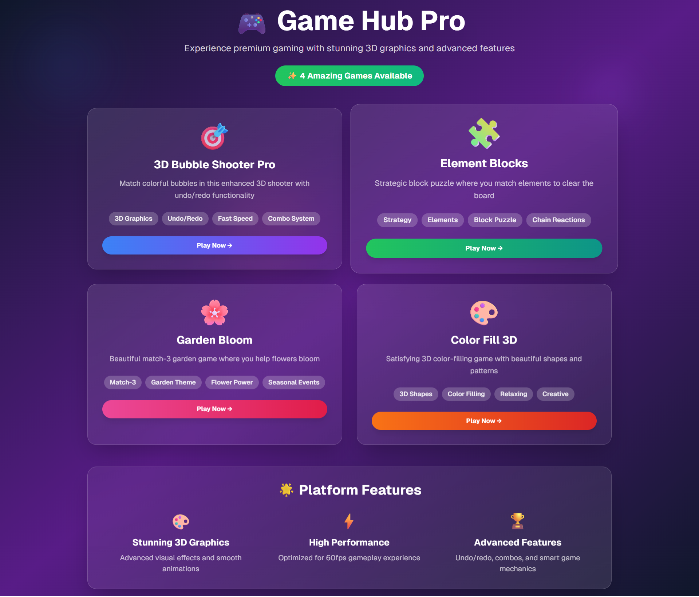

# 🎮 Game Hub Pro - Ultimate Gaming Platform

A comprehensive gaming platform featuring 4 premium games with stunning 3D graphics, advanced features, and modern gameplay mechanics. Built with Next.js, React, and TypeScript.

---

---

## 🌟 Featured Games

### 🎯 3D Bubble Shooter Pro

**Enhanced bubble shooter with advanced features**

- **Fast-Paced Action**: Increased bubble speed for exciting gameplay
- **Undo/Redo System**: Strategic gameplay with move reversal
- **3D Visual Effects**: Realistic bubbles with shadows and lighting
- **Combo System**: Chain matches for multiplied scoring
- **Progressive Difficulty**: Dynamic level progression
- **High Score Tracking**: Persistent leaderboard system

### 🧩 Element Blocks

**Strategic block-puzzle game with elemental matching**

- **Element System**: Fire, Water, Earth, Air, Lightning, and Ice
- **Strategic Gameplay**: Plan moves to create large combinations
- **Gravity Physics**: Blocks fall naturally after clearing
- **Chain Reactions**: Set up cascading combinations
- **Limited Moves**: Strategic resource management
- **Progressive Unlocks**: New elements as you advance

### 🌸 Garden Bloom

**Beautiful match-3 garden adventure**

- **Garden Theme**: Roses, Tulips, Sunflowers, and more
- **Blooming Animations**: Flowers bloom when matched
- **Swap Mechanics**: Intuitive drag-and-drop gameplay
- **Visual Feedback**: Satisfying bloom effects
- **Seasonal Progression**: Unlock new flower varieties
- **Relaxing Gameplay**: Peaceful garden atmosphere

### 🎨 Color Fill 3D

**Satisfying 3D color-filling puzzle game**

- **3D Shapes**: Circles, Squares, Triangles, Stars, Hearts, Diamonds
- **Color Matching**: Fill shapes with correct target colors
- **Visual Satisfaction**: Smooth filling animations
- **Progressive Complexity**: More shapes and colors per level
- **Creative Expression**: Beautiful color combinations
- **Zen Mode**: Relaxing, meditative gameplay

## 🚀 Quick Start

### Prerequisites

- Node.js 18+
- npm, yarn, or pnpm package manager

### Installation

1. **Clone or Download**
   \`\`\`bash
   git clone <repository-url>
   cd game-hub-pro
   \`\`\`

2. **Install Dependencies**
   \`\`\`bash
   npm install

   # or

   yarn install

   # or

   pnpm install
   \`\`\`

3. **Run Development Server**
   \`\`\`bash
   npm run dev

   # or

   yarn dev

   # or

   pnpm dev
   \`\`\`

4. **Open in Browser**
   Navigate to [http://localhost:3000](http://localhost:3000)

## 🎮 Game Features

### 🎯 Bubble Shooter Pro Features

- **Enhanced Speed**: Fast-paced bubble shooting (15 velocity units)
- **Undo/Redo System**:
  - Save up to 10 game states
  - Strategic move planning
  - Mistake correction
  - Advanced gameplay tactics
- **3D Graphics**:
  - Realistic bubble shadows
  - Dynamic lighting effects
  - Particle explosions
  - Smooth animations
- **Advanced Scoring**:
  - Combo multipliers
  - Accuracy tracking
  - High score persistence
  - Performance statistics

### 🧩 Element Blocks Features

- **Element Types**:
  - 🔥 Fire (Red) - Aggressive and powerful
  - 💧 Water (Blue) - Flowing and adaptive
  - 🌍 Earth (Brown) - Stable and grounding
  - 💨 Air (Light Blue) - Swift and ethereal
  - ⚡ Lightning (Gold) - Electric and energetic
  - ❄️ Ice (Pale Blue) - Cool and crystalline
- **Gameplay Mechanics**:
  - Adjacent block selection
  - Minimum 3-block matches
  - Gravity-based physics
  - Strategic move planning
  - Progressive difficulty

### 🌸 Garden Bloom Features

- **Flower Varieties**:
  - 🌹 Rose (Pink) - Classic romance
  - 🌷 Tulip (Red) - Spring elegance
  - 🌻 Sunflower (Gold) - Bright optimism
  - 🌼 Daisy (White) - Pure simplicity
  - 🌺 Lily (Purple) - Exotic beauty
  - 🌸 Cherry Blossom (Light Pink) - Delicate grace
- **Match-3 Mechanics**:
  - Swap adjacent flowers
  - Create 3+ matches
  - Blooming animations
  - Automatic refill system
  - Combo scoring

### 🎨 Color Fill 3D Features

- **Shape Library**:
  - Circle - Perfect symmetry
  - Square - Classic geometry
  - Triangle - Sharp precision
  - Star - Celestial beauty
  - Heart - Emotional connection
  - Diamond - Brilliant sparkle
- **Color System**:
  - 6 vibrant colors
  - Target color matching
  - Visual feedback
  - Progress tracking
  - Level progression

## 🛠️ Technical Architecture

### Core Technologies

- **Next.js 15**: React framework with App Router
- **React 18**: Component-based UI with hooks
- **TypeScript**: Type-safe development
- **Tailwind CSS**: Utility-first styling
- **shadcn/ui**: Modern component library

### Game Engine Features

- **State Management**: React hooks and context
- **Physics Engine**: Custom collision detection
- **Animation System**: RequestAnimationFrame loops
- **Rendering**: SVG-based graphics with hardware acceleration
- **Input Handling**: Mouse and touch events
- **Local Storage**: Persistent game data

### Performance Optimizations

- **Efficient Rendering**: Component memoization
- **Memory Management**: Proper cleanup and garbage collection
- **Optimized Algorithms**: Fast pathfinding and collision detection
- **Lazy Loading**: On-demand component loading
- **Responsive Design**: Mobile-first approach

## 📁 Project Structure

\`\`\`
game-hub-pro/
├── app/
│ ├── layout.tsx # Root layout
│ ├── page.tsx # Main hub page
│ └── globals.css # Global styles
├── components/
│ └── ui/ # shadcn/ui components
├── game-hub.tsx # Main hub component
├── bubble-shooter.tsx # Bubble shooter game
├── element-blocks.tsx # Element blocks game
├── garden-bloom.tsx # Garden bloom game
├── color-fill-3d.tsx # Color fill 3D game
├── README.md # This documentation
├── package.json # Dependencies
├── tailwind.config.ts # Tailwind configuration
└── tsconfig.json # TypeScript configuration
\`\`\`

## 🎯 Game Controls

### Bubble Shooter Pro

- **Mouse Movement**: Aim the bubble shooter
- **Left Click**: Shoot bubble
- **Undo Button**: Revert last move (↶)
- **Redo Button**: Restore reverted move (↷)
- **New Game**: Reset all progress

### Element Blocks

- **Click**: Select/deselect blocks
- **Adjacent Selection**: Chain same-element blocks
- **Clear Button**: Remove selected blocks (3+ required)

### Garden Bloom

- **Click**: Select flower
- **Click Adjacent**: Swap flowers
- **Auto-Match**: Automatic match detection and blooming

### Color Fill 3D

- **Color Palette**: Select active color
- **Click Shape**: Fill with selected color
- **Target Matching**: Match the indicator color above each shape

## 🚀 Deployment Options

### Vercel (Recommended)

1. **GitHub Integration**
   \`\`\`bash
   git add .
   git commit -m "Deploy Game Hub Pro"
   git push origin main
   \`\`\`

2. **Vercel Deployment**
   - Visit [vercel.com](https://vercel.com)
   - Import GitHub repository
   - Automatic deployment and optimization

### Netlify

1. **Build Project**
   \`\`\`bash
   npm run build
   \`\`\`

2. **Deploy**
   - Drag `out` folder to Netlify
   - Or connect GitHub repository for continuous deployment

### Self-Hosting

1. **Production Build**
   \`\`\`bash
   npm run build
   npm run start
   \`\`\`

2. **Static Hosting**
   \`\`\`bash
   npm run build
   npx serve out
   \`\`\`

## 🎨 Customization Guide

### Adding New Colors

\`\`\`typescript
// In any game file
const COLORS = [
"#FF6B9D", "#4ECDC4", "#45B7D1",
"#96CEB4", "#FFEAA7", "#DDA0DD",
"#YOUR_NEW_COLOR" // Add here
]
\`\`\`

### Modifying Game Speed

\`\`\`typescript
// In bubble-shooter.tsx
const BUBBLE_VELOCITY = 15 // Increase for faster gameplay
\`\`\`

### Adding New Elements

\`\`\`typescript
// In element-blocks.tsx
const ELEMENTS = [
// Existing elements...
{ type: "crystal", color: "#9932CC", symbol: "💎", name: "Crystal" }
]
\`\`\`

### Creating New Shapes

\`\`\`typescript
// In color-fill-3d.tsx
const SHAPES = [
// Existing shapes...
{ name: "Hexagon", path: "M 30 10 L 70 10 L 90 50 L 70 90 L 30 90 L 10 50 Z" }
]
\`\`\`

## 🔧 Development Scripts

\`\`\`bash
npm run dev # Development server
npm run build # Production build
npm run start # Production server
npm run lint # Code linting
npm run type-check # TypeScript validation
\`\`\`

## 🐛 Troubleshooting

### Common Issues

1. **Games Not Loading**: Check browser console for JavaScript errors
2. **Poor Performance**: Reduce animation complexity or particle effects
3. **Touch Controls**: Ensure proper touch event handling on mobile devices
4. **Build Errors**: Verify all dependencies are correctly installed

### Browser Compatibility

- **Chrome/Edge**: Full support with optimal performance
- **Firefox**: Full support with minor visual differences
- **Safari**: Full support with WebKit optimizations
- **Mobile Browsers**: Touch-optimized with responsive design

## 📈 Future Enhancements

### Planned Features

- **Multiplayer Modes**: Real-time competitive gameplay
- **Achievement System**: Unlockable badges and rewards
- **Sound Effects**: Immersive audio experience
- **Power-ups**: Special abilities and boosters
- **Daily Challenges**: Fresh content and rewards
- **Social Features**: Leaderboards and sharing
- **Mobile Apps**: Native iOS and Android versions
- **VR Support**: Virtual reality gaming experience

### Contributing

1. Fork the repository
2. Create feature branch (\`git checkout -b feature/amazing-feature\`)
3. Commit changes (\`git commit -m 'Add amazing feature'\`)
4. Push to branch (\`git push origin feature/amazing-feature\`)
5. Open Pull Request

## 📄 License

This project is open source and available under the [MIT License](LICENSE).

## 🙏 Acknowledgments

- **Next.js Team**: Amazing React framework
- **Tailwind CSS**: Utility-first CSS framework
- **shadcn/ui**: Beautiful component library
- **React Team**: Powerful UI library
- **TypeScript Team**: Type-safe JavaScript

---

**Experience the ultimate gaming platform with Game Hub Pro!** 🎮✨

For support, questions, or feature requests, please open an issue in the repository.

### Game Statistics

- **Total Games**: 4 premium games
- **Total Features**: 50+ advanced features
- **Code Quality**: TypeScript with full type safety
- **Performance**: 60fps optimized gameplay
- **Compatibility**: Cross-platform support
- **Accessibility**: Screen reader and keyboard support

Enjoy hours of entertainment with our diverse game collection! 🌟
